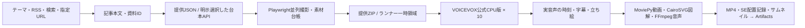

# voiceBox Pipeline

**GitHub ActionsにVOICEVOX CPU版を搭載し、10プロセス・各1スレッドで音声を作ります。** GPU・Colab・有料生成APIは使いません。MoviePy・CairoSVG・FFmpegを実際の編集処理へ組み込みました。



## GitHubで実行

[Actions → VOICEVOX CPU10 Video](https://github.com/nyu1791-collab/voiceBox-Pipeline/actions/workflows/voicevox-cpu-video.yml) → **Run workflow**。

| mode | 動作 |
|---|---|
| `demo` | 入力不要。公式VOICEVOXで異なる10台詞をCPU合成し、MoviePyの切り抜き・クロスフェード、CairoSVG、BGMダッキングを実行してMP4を残す機能デモ。正規立ち絵を使うニュース制作とは別。 |
| `production` | 提供ZIPから、ずんだもん・四国めたんの正規立ち絵・字幕・口パクを含む動画を制作する。 |

VOICEVOXは[公式CPU版0.25.2](https://github.com/VOICEVOX/voicevox_engine/releases/tag/0.25.2)をSHA-256付きで取得。10個のプロセスが同じ本体を参照します。初回の約1.8GBダウンロードと展開後は、Actionsキャッシュを利用します。各実行の終了時には起動したエンジンを終了します。

成果物は実行ページの **Artifacts → voicebox-video-実行ID**。MP4・サムネイル・技術メトリクス・CPU音声の実行記録を7日保存します。台本・原素材・音声キャッシュ・認証はGitや共有キャッシュへ入れません。動画制作は手動起動。コードのpushでは短い結合テストだけを実行します。

## 制作入力ZIP

`production` の `project_zip_url` にHTTPSのZIP URLを指定します。認証情報を含む非公開URLはリポジトリのActions Secret `PROJECT_ZIP_URL`を使います。台本をコミットする必要はありません。

```text
project.json
runtime-assets.json
characters/
  Zundamon/  # 承認済み正規PNGパーツ
  Metan/
background.jpg
materials/   # 指定画像・SVG・動画・任意BGM
```

`runtime-assets.json` は `{"shell":"characters","background":"background.jpg"}`。原素材は利用者の提供ZIPで渡し、公開リポジトリへ再配布しません。フォントは公式Zen Maru Gothic Mediumをランナーが取得します。

`project.json` の基本契約は `title`、`visuals`、`lines`。各台詞は `id`・`speaker`（ずんだもん/四国めたん）・`text`・`emotion`・`visual` を持ちます。読みを変える場合だけ `speech_text` を指定します。表情は `NORMAL/HAPPY/SERIOUS/SURPRISED/TROUBLED/SKEPTICAL`。

## 編集機能

- **MoviePy 2.2.1**：MP4等をそのまま資料として指定可能。`edit: {"start":1,"end":4,"crop":[0,0,640,360]}` で切り抜き。複数動画は `clips: [{"file":"a.mp4","start":0,"end":3},{"file":"b.mp4","start":1,"end":4}]` と `transition:0.35` でクロスフェード。編集した動画は中央の資料領域で実際に再生し、終端では最終フレームを保持する。
- **CairoSVG 2.9.1**：`visuals[].file` に自己完結したSVGを指定すると高解像度PNGへ変換。外部URLやローカルファイルを参照するSVGは読み込まない。
- **FFmpeg**：`audio: {"bgm":"materials/music.wav","bgm_gain_db":-24,"ducking":true}` で、声が出る時にBGMを下げて合成。`normalize:true` を追加すると−17LUFSを狙う正規化を有効化する。標準CLIはローカルのBGMを読み、自動取得しない。利用者の取得指示がある場合は、担当が配布元の利用条件を確認してVMへ保存する。
- **効果音**：台詞に `se: {"file":"materials/pop.wav","offset":0,"gain_db":-18,"duration":0.4}` を指定。`offset` は実音声の台詞開始からの秒数。`audio.transition_se` に同じ形式を指定すると資料が切り替わる台詞の開始へ自動配置。`audio.se: {"pop":"materials/pop.wav"}` の登録があれば台詞を `se:"pop"` と短く書ける。SEは提供素材のみ。映像は再符号化せず、声・BGM・SEを音声側で合成し、配置記録を `sound-effects.json` に残す。
- **サムネイル**：完成映像の実フレームにタイトルを重ね、1280×720の `thumbnail.png` を出力。`thumbnail_title` で短いタイトルを指定できる。キャラクターの代替画像を生成しない。
- **BudouX 0.9.0**：日本語字幕の文節に合わせて改行。英字語・数値と単位・禁則を保護し、36px・最大3行を維持。長文は縮小せず時間分割する。
- **pysubs2 1.8.1**：productionで `subtitles.srt`・`subtitles.ass`・`subtitles.vtt` と、本文・時刻を保持する `subtitles.json` を出力。映像と同じ字幕区間を使う。台詞内の時刻配分は文字数比で、単語単位の同期ではない。ASSは追加編集用であり、元の黒板・字幕板・立ち絵の全レイアウトを再現しない。

画像・動画・BGMの相対パスは台本JSONのフォルダが基準。`visuals` の各項目に `id`、出典情報 `source_credit/source_url` を付けます。画像の代わりに `clips` を指定する場合は `file` を省略できます。

標準の最終動画は360p（640×360）・24fps、H.264 preset veryfast・CRF20、AAC 48kHz mono。1280×720のレイアウトで描画し、最終映像を360pへ縮小します。字幕は描画時にZen Maru Gothic Medium 36px・最大3行。声はVOICEVOX style3/2、原音話速1.10・後段1.15。字幕本文を保持し、長文は時間方向に分けます。静止画だけの既存台本も同じ入口で動きます。

## Google Driveへリポジトリを同期

GitHub Actionsから追跡対象ファイルのスナップショットをGoogle Driveへ送れます。初回設定と実行方法は[Google Drive同期手順](docs/GOOGLE_DRIVE_SYNC.md)を参照してください。

## VM・Linuxでも実行

既存VMでは `./zundamon-video setup` で保存済みエンジンと素材を登録し、`./zundamon-video run /path/project.json --out /path/new-output`。既存サービス・完成動画・別作業は上書きしません。

別のLinuxではPython 3.10以降・FFmpeg・Cairo・7zipを用意し、`python3 -m venv .venv`、`.venv/bin/pip install -r requirements.txt`。

```bash
.venv/bin/python tools/install_voicevox.py --directory "$HOME/.cache/voicebox-tools/voicevox-0.25.2"
./zundamon-video setup --engine-dir "$HOME/.cache/voicebox-tools/voicevox-0.25.2" \
  --shell /path/to/approved/characters --font /path/to/ZenMaruGothic-Medium.ttf \
  --background /path/to/blackboard.jpg
./zundamon-video run /path/project.json --out /path/new-output
```

10プロセスは10倍速を保証しません。実行記録の `max_parallel_synthesis`・起動時間・音声工程・描画時間を見ます。同じ音声と成功済み動画は再利用し、入力が変わった時は新しい出力先を指定します。

公式エンジンのSHA計算結果はユーザーの `$XDG_CACHE_HOME/voicebox-tools/engine-fingerprints/`（未設定時は `~/.cache/voicebox-tools/engine-fingerprints/`）に保存し、新しい作業用cloneでも再利用します。エンジン内の対象ファイルのパス・サイズ・mtime・ctimeが一致する時だけ使い、変更時は再計算します。壊れたキャッシュは再計算し、キャッシュへ書き込めない場合も計算済みSHAで続行します。台本・素材・認証情報はこのキャッシュに保存しません。

## 情報収集からJSON台本へ

[Actions → Research and JSON Project](https://github.com/nyu1791-collab/voiceBox-Pipeline/actions/workflows/prepare-project.yml) でテーマを入力。既定の `provider:none` はAPIキー不要でRSS・DuckDuckGo検索・本文抽出を行い、`research.json` と `script-prompt.json` をArtifactsへ残す。検索結果だけを正しい台本と見なしたり、台本未生成の状態を完成動画と表示したりしません。

GeminiまたはGroqで台本も生成する場合は、providerと具体的なmodelを指定し、選択したサービスのActions Secret `GEMINI_API_KEY` / `GROQ_API_KEY` を設定。1回の明示呼出しだけで、別モデルへのfallbackや自動再試行はありません。無料枠の適用はそのアカウント・モデルの条件によります。Tavily・Perplexityの有料APIは標準経路へ追加していません。

OpenCode無料版は `provider:opencode`、`model:deepseek-v4.1-flash-free` とSecret `OPENCODE_API_KEY` を使います。[公式告知](https://x.com/opencode/status/2112220734768779441)では、この無料版も1017へ更新済みで、モデルIDの変更は不要です。無料提供は期間限定で、Goの有料モデルとは区別します。直接推論APIの `403 FreeTierError` を回避する独自ヘッダーは作らず、動作を確認した公式 `opencode-ai@1.19.0` のローカルサーバーを使います。ActionsはOpenCode選択時だけCLIを導入します。ローカルでは事前に `npm install --global opencode-ai@1.19.0` を実行してください。

接続だけを調べる場合は [OpenCode Free Connection](https://github.com/nyu1791-collab/voiceBox-Pipeline/actions/workflows/check-opencode-free.yml) を手動実行します。架空資料から短いJSON台本を1回生成して検証し、台本本文を保存せず、モデル・正常終了・トークン数・カタログ上のコスト等の非秘密receiptだけをArtifactsへ残します。音声・動画・記事取得は実行しません。CLIは認証付きのloopbackで一時起動し、他サービスの認証や既存設定を渡さず、ツール要求・再試行・別モデル・不完全な応答を検知したら停止します。

ローカルでは次の入口を使います。`request.json`・`script.json` は利用者の作業フォルダに置き、Gitへコミットしません。

```bash
.venv/bin/python -m playwright install chromium
.venv/bin/python tools/prepare_project.py --request /work/request.json --output /work/new-source-pack
# 提供台本を使う場合：追加API呼出しなし
.venv/bin/python tools/prepare_project.py --request /work/request.json --script /work/script.json --output /work/new-project
# 選択した台本APIを明示実行する場合だけ --allow-api を追加
```

リクエストは `{"topic":"解説するテーマ","queries":["検索語"],"urls":["https://example.org/article"],"feeds":[],"minutes":10,"max_sources":8,"provider":"none"}`。`news:false`・`search:false` で指定URL/RSSだけの収集にもできます。RSSはGoogle News検索RSSを既定とし、任意のRSS/Atomも指定可能。DDGSが検索、Trafilaturaが本文を抽出します。取得時刻・公開日・URL・本文SHA・失敗は素材パックに残します。本文未取得の記事は台本資料に使いません。

提供台本は既存の `title/lines` 形式に加え、画像のような配列形式も受け付けます。`speaker:zundamon/metan` と小文字の `emotion` を正規形式へ変換し、台詞本文は保持。各台詞の `source_id` を `research.json` の資料IDへ結びます。`search_keyword` は同じ検索語の取得済み記事へ対応付けできます。検索語だけで未取得の画面を作ることはありません。

台本がある場合、Playwright Chromiumが参照する記事だけを最大4並列で撮影。既存Cookieは使わず、広告や本文を勝手に書き換えません。本文見出しと文章を持つ領域を選び、高さ700px以内で切り出し、URL・撮影時刻・SHA付きで `materials/manifest.json` へ記録。関連記事の先頭カードを自動的に本文と決めつけません。撮影失敗は記録して停止し、別画像へ置換しません。全体の `capture_selector`、または `capture_overrides: {"資料ID":{"selector":".article-body","heading":"本文見出し","crops":[{"name":"claim","text":"切り抜く段落の一部"}]}}` で指定できます。指定段落があればその切り抜きを資料として優先し、見つからない場合は停止します。10サイトが何秒で完了するかは接続先次第です。

生成した `project.json` と `materials/` に正規立ち絵・背景・`runtime-assets.json` を合わせて入力ZIPにすれば、そのままproductionへ渡せます。また、production ZIPの `project.json` を `research-request.json` に置き換え、provider/modelを指定し、起動時の `allow_script_api` を有効にすると、記事収集→JSON台本→撮影→CPU音声→動画まで同じランナーで続行します。台本APIのSecretがない場合は自動生成できません。目標分数は台本作成の目安で、最終実尺は音声生成後のmetricsで示します。

OpenCodeの場合は、動画workflowでも `script_provider:opencode` を明示選択してください。ZIPの `research-request.json` のproviderと一致しない場合は停止します。既存のGemini/Groqは既定の `script_provider:request` を使います。提供済みの `project.json` から制作する場合は台本APIを呼びません。

`RESEARCH_READY` は情報収集済み、`PROJECT_READY` は台本と撮影素材の準備済み。MP4完成とは区別します。これらのAPIによる新規台本生成・任意ニュース全体の正確性まで、ローカルの結合テストが保証するものではありません。YouTubeへの自動投稿は含めません。

見直した5工程と実装の境界は [必読ルール](docs/RULES.md#全体を把握する) に記載。現行のresearch-request制作は調査→台本→撮影→音声→描画の順。テーマだけで起動する統一入口、音声と撮影の並列化、共通素材の独立登録、完成MP4のDrive自動転送は未接続です。Google Newsの集約URLから配信元の記事を解決する処理も未実装で、本文未取得を取得成功に数えません。

必読は [docs/RULES.md](docs/RULES.md) だけ。ツールの由来と条件は [THIRD_PARTY.md](THIRD_PARTY.md)。過去のVM動作記録は [docs/RUN_RESULT.md](docs/RUN_RESULT.md) です。

資料ごとに複数のスクショを切り替える場合、`capture_overrides.<source_id>.crops` の各項目に `name`・引用段落の `text`・対応する台詞IDの `line_ids` を指定します。例：`{"name":"typing","text":"TypeIs","line_ids":[6]}`。同じ出典の台詞だけに割り当てられ、指定段落が見つからない場合は制作を停止します。

英語の証拠画像は `visuals` に `source_language: "en"` と `translation` を指定します。引用段落を自動撮影する入力では、`capture_overrides.<source_id>.crops` の各項目へ同じ2項目を設定できます。日本語訳は画像直下に28pxで表示し、長文は全文を保ってページを切り替えます。英語と明示された画像で訳がなければ停止します。台詞字幕とは独立した表示です。

BGMは `audio.bgm` のローカル音源を使用し、`bgm_gain_db`（既定−24dB）、`ducking`（既定true）、`bgm_fade_seconds`（既定1.5秒）で調整します。配布元のライセンスと必要なクレジットは作品の概要欄に保持してください。音声結合は映像をコピーし、最後のフレームまで保持します。

現行工程・検証済み完成物・既存音声の再利用・未実装範囲は、[動画制作の詳細移行文](docs/MIGRATION_VIDEO_WORKFLOW_20261020.md)を参照してください。
