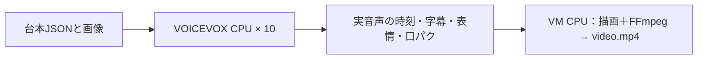

# voiceBox Pipeline

台本JSONと画像から、ずんだもん・四国めたんの動画を一度のコマンドで完成させます。VOICEVOXは**CPU専用の10プロセス、各1スレッド**。GPU・Colab・有料APIは呼びません。



## VMで使う

```bash
cd ~/voiceBox-Pipeline
./zundamon-video setup
./zundamon-video run examples/project.json --out runs/example
```

`setup` は初回だけ。VMにあるVOICEVOX 0.25.2、承認済み立ち絵パーツ・黒板・Zen Maru Gothicを登録します。エンジン本体は1か所に置いて10プロセスから参照し、10回ダウンロードする構成にはしません。

完成物は指定先の `video.mp4`、`script.txt`、`description.txt`。`state.json` に実尺・所要時間・CPU並列数、`cpu-voice-receipt.json` に10エンジンの起動時間・合成区間・終了結果を残します。途中確認・査読・監査・プレビュー待ちはありません。実行例の所要時間は [動作記録](docs/RUN_RESULT.md) を参照してください。

## 自分の台本を入れる

`examples/project.json` をコピーし、`title`・`lines`・`visuals` を変えます。画像の相対パスは**台本JSONのあるフォルダ**が基準です。

```json
{
  "title": "動画のタイトル",
  "visuals": [{"id": "main", "file": "image.png", "source_credit": "提供素材"}],
  "lines": [
    {"id": 1, "speaker": "ずんだもん", "text": "最初に要点を説明するのだ。", "emotion": "NORMAL", "visual": "main"},
    {"id": 2, "speaker": "四国めたん", "text": "身近な例で教えてちょうだい。", "emotion": "HAPPY", "visual": "main"}
  ]
}
```

英字などの読みだけ変える場合は `speech_text` を追加します。字幕は `text` を使います。`emotion` は `NORMAL/HAPPY/SERIOUS/SURPRISED/TROUBLED/SKEPTICAL`。`section` を指定すると切替の見出しにも使えます。素材には必要に応じて `source_url`・`source_label`・短い `summary` または `translation` を付けられます。

- 1280×720・30fps、H.264 CRF20、AAC 48kHz mono。映像は一度だけ符号化し、音声の結合時は映像をコピーします。
- 黒板、36px・最大3行、淡い話者色の字幕板、正規パーツの表情とRMS口パク。字幕が長い場合は、文字を落とさず表示を時間分割します。
- 原音話速1.10、後段1.15。音声の実サンプル数から時刻を作るので、並列処理の完了順によって台詞が並び替わることはありません。
- 同一音声はSHA付きキャッシュで再利用します。全音声が再利用できる時は10エンジンを起動しません。同じ入力・同じ完成先の再実行は完成動画を返します。変更した入力は別の `--out` を指定します。
- 10本以上の異なる台詞で10並列を活用します。台詞が少ない時やキャッシュ済みの場合、実際に合成する本数は少なくなります。10並列が10倍速になるという意味ではありません。

## 別のLinuxで使う

まず `git clone https://github.com/nyu1791-collab/voiceBox-Pipeline.git`、`cd voiceBox-Pipeline`。Python 3.10以降・FFmpegを用意し、`python3 -m venv .venv`、`.venv/bin/pip install -r requirements.txt`。公式VOICEVOXのCPU版と正規キャラクターパーツを用意して、初回登録します。

```bash
./zundamon-video setup --engine-dir /path/to/linux-cpu-x64 \
  --shell /path/to/Shikokumetan_Zundamon_Shell --font /path/to/ZenMaruGothic-Medium.ttf \
  --background /path/to/blackboard.jpg
```

10プロセス分のメモリとCPUを使います。エンジン本体・原素材・認証・生成動画はGitへ入れません。旧プロジェクトへの書込みはありません。VMの `video-ops` があれば自動で共通ロックを使います。終了・失敗時には今回起動した10プロセスを終了し、既存の50021番サービスは触りません。

開発時の必読は [docs/RULES.md](docs/RULES.md) だけ。既存描画コードの由来は [source-provenance.json](source-provenance.json)、利用する外部ツールは [THIRD_PARTY.md](THIRD_PARTY.md)。
