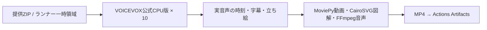

# voiceBox Pipeline

**GitHub ActionsにVOICEVOX CPU版を搭載し、10プロセス・各1スレッドで音声を作ります。** GPU・Colab・有料生成APIは使いません。MoviePy・CairoSVG・FFmpegを実際の編集処理へ組み込みました。



## GitHubで実行

[Actions → VOICEVOX CPU10 Video](https://github.com/nyu1791-collab/voiceBox-Pipeline/actions/workflows/voicevox-cpu-video.yml) → **Run workflow**。

| mode | 動作 |
|---|---|
| `demo` | 入力不要。公式VOICEVOXで異なる10台詞をCPU合成し、MoviePyの切り抜き・クロスフェード、CairoSVG、BGMダッキングを実行してMP4を残す機能デモ。正規立ち絵を使うニュース制作とは別。 |
| `production` | 提供ZIPから、ずんだもん・四国めたんの正規立ち絵・字幕・口パクを含む動画を制作する。 |

VOICEVOXは[公式CPU版0.25.2](https://github.com/VOICEVOX/voicevox_engine/releases/tag/0.25.2)をSHA-256付きで取得。10個のプロセスが同じ本体を参照します。初回の約1.8GBダウンロードと展開後は、Actionsキャッシュを利用します。各実行の終了時には起動したエンジンを終了します。

成果物は実行ページの **Artifacts → voicebox-video-実行ID**。MP4・技術メトリクス・CPU音声の実行記録を7日保存します。台本・原素材・音声キャッシュ・認証はGitや共有キャッシュへ入れません。ワークフロー定義を変更したpushでは機能デモを一度実行し、それ以外は手動起動です。

## 制作入力ZIP

`production` の `project_zip_url` にHTTPSのZIP URLを指定します。認証情報を含む非公開URLはリポジトリのActions Secret `PROJECT_ZIP_URL`を使います。台本をコミットする必要はありません。

```text
project.json
runtime-assets.json
characters/
  Zundamon/  # 承認済み正規PNGパーツ
  Metan/
background.jpg
materials/   # 指定画像・SVG・動画・任意BGM
```

`runtime-assets.json` は `{"shell":"characters","background":"background.jpg"}`。原素材は利用者の提供ZIPで渡し、公開リポジトリへ再配布しません。フォントは公式Zen Maru Gothic Mediumをランナーが取得します。

`project.json` の基本契約は `title`、`visuals`、`lines`。各台詞は `id`・`speaker`（ずんだもん/四国めたん）・`text`・`emotion`・`visual` を持ちます。読みを変える場合だけ `speech_text` を指定します。表情は `NORMAL/HAPPY/SERIOUS/SURPRISED/TROUBLED/SKEPTICAL`。

## 編集機能

- **MoviePy 2.2.1**：MP4等をそのまま資料として指定可能。`edit: {"start":1,"end":4,"crop":[0,0,640,360]}` で切り抜き。複数動画は `clips: [{"file":"a.mp4","start":0,"end":3},{"file":"b.mp4","start":1,"end":4}]` と `transition:0.35` でクロスフェード。編集した動画は中央の資料領域で実際に再生し、終端では最終フレームを保持する。
- **CairoSVG 2.9.1**：`visuals[].file` に自己完結したSVGを指定すると高解像度PNGへ変換。外部URLやローカルファイルを参照するSVGは読み込まない。
- **FFmpeg**：`audio: {"bgm":"materials/music.wav","bgm_gain_db":-24,"ducking":true}` で、声が出る時にBGMを下げて合成。`normalize:true` を追加すると−17LUFSを狙う正規化を有効化する。BGMは提供素材だけを使い、自動取得しない。

画像・動画・BGMの相対パスは台本JSONのフォルダが基準。`visuals` の各項目に `id`、出典情報 `source_credit/source_url` を付けます。画像の代わりに `clips` を指定する場合は `file` を省略できます。

標準は1280×720・30fps、H.264 CRF20、AAC 48kHz mono。字幕はZen Maru Gothic Medium 36px・最大3行。声はVOICEVOX style3/2、原音話速1.10・後段1.15。字幕本文を保持し、長文は時間方向に分けます。静止画だけの既存台本も同じ入口で動きます。

## VM・Linuxでも実行

既存VMでは `./zundamon-video setup` で保存済みエンジンと素材を登録し、`./zundamon-video run /path/project.json --out /path/new-output`。既存サービス・完成動画・別作業は上書きしません。

別のLinuxではPython 3.10以降・FFmpeg・Cairo・7zipを用意し、`python3 -m venv .venv`、`.venv/bin/pip install -r requirements.txt`。

```bash
.venv/bin/python tools/install_voicevox.py --directory "$HOME/.cache/voicebox-tools/voicevox-0.25.2"
./zundamon-video setup --engine-dir "$HOME/.cache/voicebox-tools/voicevox-0.25.2" \
  --shell /path/to/approved/characters --font /path/to/ZenMaruGothic-Medium.ttf \
  --background /path/to/blackboard.jpg
./zundamon-video run /path/project.json --out /path/new-output
```

10プロセスは10倍速を保証しません。実行記録の `max_parallel_synthesis`・起動時間・音声工程・描画時間を見ます。同じ音声と成功済み動画は再利用し、入力が変わった時は新しい出力先を指定します。

必読は [docs/RULES.md](docs/RULES.md) だけ。ツールの由来と条件は [THIRD_PARTY.md](THIRD_PARTY.md)。過去のVM動作記録は [docs/RUN_RESULT.md](docs/RUN_RESULT.md) です。
