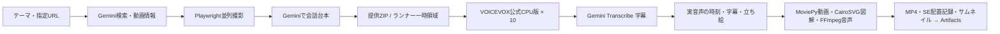

# voiceBox Pipeline

**GitHub ActionsにVOICEVOX CPU版を搭載し、10プロセス・各1スレッドで音声を作ります。** 音声生成にGPU・Colabは使いません。Geminiの利用条件・料金はAPIアカウントによります。MoviePy・CairoSVG・FFmpegを編集処理へ組み込みました。



## GitHubで実行

[Actions → VOICEVOX CPU10 Video](https://github.com/nyu1791-collab/voiceBox-Pipeline/actions/workflows/voicevox-cpu-video.yml) → **Run workflow**。

| mode | 動作 |
|---|---|
| `demo` | 入力不要。公式VOICEVOXで異なる10台詞をCPU合成し、MoviePyの切り抜き・クロスフェード、CairoSVG、BGMダッキングを実行してMP4を残す機能デモ。正規立ち絵を使うニュース制作とは別。 |
| `production` | 提供ZIPから、ずんだもん・四国めたんの正規立ち絵・字幕・口パクを含む動画を制作する。 |

VOICEVOXは[公式CPU版0.25.2](https://github.com/VOICEVOX/voicevox_engine/releases/tag/0.25.2)をSHA-256付きで取得。10個のプロセスが同じ本体を参照します。初回の約1.8GBダウンロードと展開後は、Actionsキャッシュを利用します。各実行の終了時には起動したエンジンを終了します。

成果物は実行ページの **Artifacts → voicebox-video-実行ID**。調査入力から制作した場合、資料・スクリーンショット・台本は **voicebox-source-pack-実行ID** にも7日保存します。台本・原素材・音声キャッシュ・認証はGitや共有キャッシュへ入れません。動画制作は手動起動し、結合テストも必要な時だけ実行します。

## 制作入力ZIP

`production` の `project_zip_url` にHTTPSのZIP URLを指定します。認証情報を含む非公開URLはリポジトリのActions Secret `PROJECT_ZIP_URL`を使います。台本をコミットする必要はありません。

```text
project.json
runtime-assets.json
characters/
  Zundamon/  # 承認済み正規PNGパーツ
  Metan/
background.jpg
materials/   # 指定画像・SVG・動画・任意BGM
```

`runtime-assets.json` は `{"shell":"characters","background":"background.jpg"}`。原素材は利用者の提供ZIPで渡し、公開リポジトリへ再配布しません。フォントは公式Zen Maru Gothic Mediumをランナーが取得します。

`project.json` の基本契約は `title`、`visuals`、`lines`。各台詞は `id`・`speaker`（ずんだもん/四国めたん）・`text`・`emotion`・`visual` を持ちます。読みを変える場合だけ `speech_text` を指定します。表情は `NORMAL/HAPPY/SERIOUS/SURPRISED/TROUBLED/SKEPTICAL`。

## 編集機能

- **MoviePy 2.2.1**：MP4等をそのまま資料として指定可能。`edit: {"start":1,"end":4,"crop":[0,0,640,360]}` で切り抜き。複数動画は `clips: [{"file":"a.mp4","start":0,"end":3},{"file":"b.mp4","start":1,"end":4}]` と `transition:0.35` でクロスフェード。編集した動画は中央の資料領域で実際に再生し、終端では最終フレームを保持する。
- **CairoSVG 2.9.1**：`visuals[].file` に自己完結したSVGを指定すると高解像度PNGへ変換。外部URLやローカルファイルを参照するSVGは読み込まない。
- **FFmpeg**：`audio: {"bgm":"materials/music.wav","bgm_gain_db":-24,"ducking":true}` で、声が出る時にBGMを下げて合成。`normalize:true` を追加すると−17LUFSを狙う正規化を有効化する。標準CLIはローカルのBGMを読み、自動取得しない。利用者の取得指示がある場合は、担当が配布元の利用条件を確認してVMへ保存する。
- **効果音**：台詞に `se: {"file":"materials/pop.wav","offset":0,"gain_db":-18,"duration":0.4}` を指定。`offset` は実音声の台詞開始からの秒数。`audio.transition_se` に同じ形式を指定すると資料が切り替わる台詞の開始へ自動配置。`audio.se: {"pop":"materials/pop.wav"}` の登録があれば台詞を `se:"pop"` と短く書ける。SEは提供素材のみ。映像は再符号化せず、声・BGM・SEを音声側で合成し、配置記録を `sound-effects.json` に残す。
- **サムネイル**：完成映像の実フレームにタイトルを重ね、1280×720の `thumbnail.png` を出力。`thumbnail_title` で短いタイトルを指定できる。キャラクターの代替画像を生成しない。
- **BudouX 0.9.0**：日本語字幕の文節に合わせて改行。英字語・数値と単位・禁則を保護し、36px・最大3行を維持。長文は縮小せず時間分割する。
- **字幕**：VOICEVOX合成音声を `gemini-3.5-transcribe` に送り、認識文字と単語時刻を動画と `subtitles.srt`・`subtitles.ass`・`subtitles.vtt` に使います。話者はVOICEVOXの記録に対応付けます。APIの時刻は推定であり完全な同期を保証しません。ASSは追加編集用であり、黒板や立ち絵の全レイアウトは含みません。

字幕用の音声は原則として台詞の終わりで分け、最大5件を並列処理します。長さ・並列数は運用上の目安です。認識済み区間は同じ出力先で再開すると再利用し、429などの一時的なエラーは最大3回まで試します。認識できない台詞は従来の台本ベース字幕で続行し、`transcription.json` の `status` と `fallback_line_ids` に記録します。`GEMINI_API_KEY` とそのモデルの利用設定が必要で、料金は利用条件に依存します。

画像・動画・BGMの相対パスは台本JSONのフォルダが基準。`visuals` の各項目に `id`、出典情報 `source_credit/source_url` を付けます。画像の代わりに `clips` を指定する場合は `file` を省略できます。

標準の最終動画は360p（640×360）・24fps、H.264 preset veryfast・CRF20、AAC 48kHz mono。1280×720のレイアウトで描画し、最終映像を360pへ縮小します。字幕は描画時にZen Maru Gothic Medium 36px・最大3行。声はVOICEVOX style3/2、原音話速1.10・後段1.15。認識した字幕本文を保持し、長文は時間方向に分けます。静止画だけの既存台本も同じ入口で動きます。

## Google Driveへリポジトリを同期

GitHub Actionsから追跡対象ファイルのスナップショットをGoogle Driveへ送れます。初回設定と実行方法は[Google Drive同期手順](docs/GOOGLE_DRIVE_SYNC.md)を参照してください。

## VM・Linuxでも実行

既存VMでは `./zundamon-video setup` で保存済みエンジンと素材を登録し、`./zundamon-video run /path/project.json --out /path/new-output`。既存サービス・完成動画・別作業は上書きしません。

別のLinuxではPython 3.10以降・FFmpeg・Cairo・7zipを用意し、`python3 -m venv .venv`、`.venv/bin/pip install -r requirements.txt`。

```bash
.venv/bin/python tools/install_voicevox.py --directory "$HOME/.cache/voicebox-tools/voicevox-0.25.2"
./zundamon-video setup --engine-dir "$HOME/.cache/voicebox-tools/voicevox-0.25.2" \
  --shell /path/to/approved/characters --font /path/to/ZenMaruGothic-Medium.ttf \
  --background /path/to/blackboard.jpg
./zundamon-video run /path/project.json --out /path/new-output
```

10プロセスは10倍速を保証しません。実行記録の `max_parallel_synthesis`・起動時間・音声工程・描画時間を見ます。同じ音声と成功済み動画は再利用し、入力が変わった時は新しい出力先を指定します。

公式エンジンのSHA計算結果はユーザーの `$XDG_CACHE_HOME/voicebox-tools/engine-fingerprints/`（未設定時は `~/.cache/voicebox-tools/engine-fingerprints/`）に保存し、新しい作業用cloneでも再利用します。エンジン内の対象ファイルのパス・サイズ・mtime・ctimeが一致する時だけ使い、変更時は再計算します。壊れたキャッシュは再計算し、キャッシュへ書き込めない場合も計算済みSHAで続行します。台本・素材・認証情報はこのキャッシュに保存しません。

## 情報収集からJSON台本へ

[Actions → Research and JSON Project](https://github.com/nyu1791-collab/voiceBox-Pipeline/actions/workflows/prepare-project.yml) でテーマを入力します。既定は `gemini-3.8-flash`・思考 `medium`。GeminiがGoogle検索で記事とYouTubeを探し、Playwrightで画面を撮影した後、画像・公開YouTube動画・記事URLを同じGeminiへ渡してずんだもんと四国めたんの会話を作ります。URLは任意で指定できます。`GEMINI_API_KEY` をActions Secretに設定してください。Gemini APIは調査と台本作成の計2回を呼び、Google検索の利用条件・料金は利用アカウントに依存します。

`research.json` にGeminiの資料要約と検索結果、`materials/manifest.json` に撮影結果、`project.json` に台本と画像の対応を保存します。あわせて画像検索で関連画像を取得し、`materials/related/manifest.json` に画像ごとの出典ページを保存します。Geminiは画像を見て、会話に合う画像を選べます。完成映像には出典のドメインを表示し、概要欄には出典ページのURLを残します。画像検索はDDGSを使用し、Google画像検索とは別です。

Geminiの要約は記事全文ではありません。撮れなかった資料の情報も台本に使い、失敗は `preparation.json` に残します。その資料の台詞に別の画像を表示した場合は `visual_context_only` と記録します。画面も関連画像も取得できない場合は、出典画像と区別した無地の背景で続けます。同じ入力と出力先では、保存済みの調査・撮影や完成台本を再利用します。目標分数・資料件数は目安です。

画像だけを取得する場合は「Research and JSON Project」の `image_query` に検索語を指定します。この実行ではGeminiを呼びません。

Gemini経路では、以前の実行IDを `resume_run_id` に指定すると、同じ入力で調査と画像を再利用できます。`regenerate_dialogue` を有効にした場合だけ、保存済みの資料を使って台本を作り直します。

YouTube側で再生にログイン確認が必要な場合、動画フレームの代わりに公開ページのタイトルや説明を撮影し、`capture_kind` に記録します。動画の内容はGeminiに公開URLを渡して読み取ります。

YouTubeの撮影だけを行う場合は「Research and JSON Project」の `capture_url` に動画URLを指定します。再生できたときは実際の動画フレームを保存し、確認画面や広告で再生できないときは資料画面を保存して区別します。この実行ではGeminiを呼びません。

YouTube画面の撮影に自分のアカウントを使う場合は、専用のブラウザで正規ログインし、その状態をGitHub Secretに登録します。認証状態はYouTubeの撮影だけに使用し、成果物には保存しません。Google側が追加確認を求める場合は、Actions側から許可を強制できません。

```bash
python -m playwright codegen --save-storage youtube-auth.json https://www.youtube.com/
gh secret set YOUTUBE_STORAGE_STATE --repo nyu1791-collab/voiceBox-Pipeline < youtube-auth.json
rm youtube-auth.json
```

ローカルでは次の入口を使います。`request.json` と成果物は利用者の作業フォルダに置きます。

```bash
.venv/bin/python -m playwright install chromium
.venv/bin/python tools/prepare_project.py --request /work/request.json --output /work/new-source-pack
# 提供台本を使う場合：追加API呼出しなし
.venv/bin/python tools/prepare_project.py --request /work/request.json --script /work/script.json --output /work/new-project
```

Geminiのリクエスト例は `{"topic":"解説するテーマ","urls":["https://www.youtube.com/watch?v=動画ID"],"minutes":10,"provider":"gemini"}`。model省略時は `gemini-3.8-flash` です。提供台本を使う場合は `--script` を指定します。`provider:none` は従来どおりRSS・DuckDuckGoで収集のみ行います。新規の調査・会話作成は `provider:gemini` に統一しています。

OpenCodeからこのGemini経路を使うための `voicebox-research` スキルを同梱しています。OpenCode自体はオープンソースですが、選択したモデルの利用料金は別です。OpenCode Goは任意の契約であり、このスキルの利用に加入は不要です。

OpenCodeを使う場合は、リポジトリ内で `voicebox-research` スキルにテーマ・任意URL・尺の目安を渡します。OpenCodeは実行の入口であり、資料調査と会話台本の作成は Gemini 3.8 Flash / MEDIUM が担当します。GitHub Actions の既定入口と同じ `tools/prepare_project.py` を使うため、OpenCode専用の別台本providerは選びません。

生成した `project.json` と `materials/` に立ち絵・背景・`runtime-assets.json` を合わせて入力ZIPにできます。production ZIPに `research-request.json` を入れる場合も、`provider:gemini` の指定だけで調査→撮影→台本→CPU音声→動画まで進みます。Gemini以外の台本APIには従来の許可指定を使います。`PROJECT_READY` は台本と画像の準備完了であり、MP4生成は別工程です。

## AgentRouterのコーディングAPI接続

[AgentRouter Coding Connection](https://github.com/nyu1791-collab/voiceBox-Pipeline/actions/workflows/check-agentrouter.yml) で、Secret `AGENTROUTER_API_KEY` と明示選択したモデルを使い、公式OpenCodeクライアントから接続を確認できます。キー発行・設定・利用枠・現時点の確認状態は [接続手順](docs/AGENTROUTER_GITHUB.md) を参照してください。

## YouTubeの公開動画を検索

[Actions → YouTube Search Research](https://github.com/nyu1791-collab/voiceBox-Pipeline/actions/workflows/youtube-research.yml) から手動実行できます。日本語の検索語と結果数（1〜5件）を入力すると、YouTube Data API v3で公開動画のタイトル・チャンネル・公開日・説明文を取得し、`youtube-search.json` をArtifactsへ7日間保存します。APIキーはリポジトリSecret `YOUTUBE_API_KEY` から読み、出力には含めません。`search.list` は1回100クォータ単位を消費するため、手動実行に限定し、定期実行や自動投稿は設定していません。

見直した5工程と実装の境界は [必読ルール](docs/RULES.md#全体を把握する) に記載。音声と撮影の並列化、共通素材の独立登録、完成MP4のDrive自動転送は未接続です。

作業入口は [Gemini と OpenCode の入口](docs/GEMINI_OPENCODE_ENTRYPOINT.md)。ツールの由来と条件は [THIRD_PARTY.md](THIRD_PARTY.md)。過去のVM動作記録は [docs/RUN_RESULT.md](docs/RUN_RESULT.md) です。

資料ごとに複数のスクショを切り替える場合、`capture_overrides.<source_id>.crops` の各項目に `name`・引用段落の `text`・対応する台詞IDの `line_ids` を指定します。Gemini経路では指定段落が撮れない時、同じページの撮影済み画面を使って続行します。

英語の証拠画像は `visuals` の `translation` に日本語訳を指定できます。訳がある場合は画像直下に表示し、長文はページを切り替えます。訳がない場合も処理は続きます。

BGMは `audio.bgm` のローカル音源を使用し、`bgm_gain_db`（既定−24dB）、`ducking`（既定true）、`bgm_fade_seconds`（既定1.5秒）で調整します。配布元のライセンスと必要なクレジットは作品の概要欄に保持してください。音声結合は映像をコピーし、最後のフレームまで保持します。

現行工程・検証済み完成物・既存音声の再利用・未実装範囲は、[動画制作の詳細移行文](docs/MIGRATION_VIDEO_WORKFLOW_20261020.md)を参照してください。
