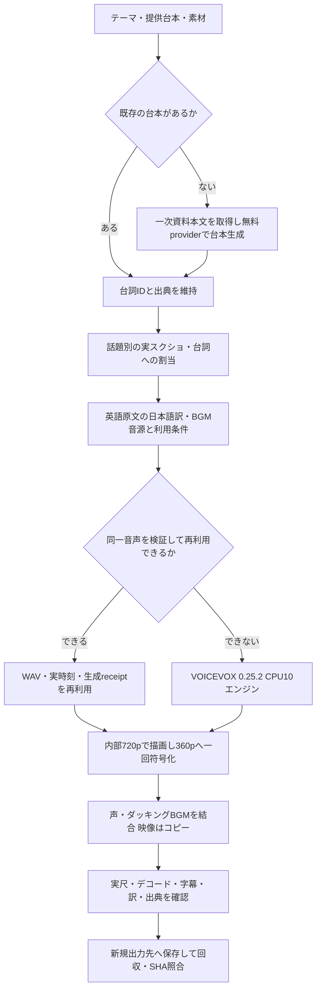

# 移行文：動画制作工程・日本語訳・BGM対応

更新日：2026-10-20 UTC。対象：`nyu1791-collab/voiceBox-Pipeline`、`main`。

この文書は、OpenCode無料台本生成の接続から、証拠スクショを多用した360p動画、日本語訳とBGM入り動画までの引き継ぎである。ルールの正本は [RULES.md](RULES.md)。接続当初の詳細は [OpenCode接続メモ](MIGRATION_OPENCODE_FREE_SCRIPT_API_20261020.md)、30fps時点のCPU実測は [過去の実行記録](RUN_RESULT.md)。過去文書の設定を現在の値へ戻すために使わない。

公開Gitには、台本・原画像・キャラクター素材・音源・完成動画を入れない。実際のVM上の絶対パスと再開用情報は、利用者へ渡した非公開の詳細移行文にまとめた。

## 1. 利用者が確定した方針

- OpenCode経由の無料DeepSeekを使う。告知上の1017更新を理由に架空のモデルIDへ変更しない。
- 最終出力は **360p、640×360、24fps、H.264 veryfast・CRF20**。内部描画は1280×720。
- ページ全体を小さく映すだけで済ませず、話題に対応する実際のスクリーンショットを増やす。
- 英語の証拠画像の直下に日本語訳を付ける。
- 無料利用条件を確認できるBGMをVM上で取得し、声を邪魔しない音量で取り入れる。
- AIは実行を進め、詰まりを修正する。途中の不要な許可取りを繰り返さない。
- GPU・Colab・有料モデルへの自動切替・無断公開は行わない。

当初の「OpenCodeへ任せて触るな」という指示の後に、利用者が改善・修正も行うよう明示した。現在は既に認められた範囲で担当AIが修正とVM実行を行える。台本生成用providerと、VM制作を行うOpenCodeエージェントの権限を混同しない。

## 2. 到達点と正本の版

実装基準コミット：`1698e90cb06ebc9e7287dba29a89925968cd83f6`。

| 変更 | コミット |
|---|---|
| OpenCode無料台本provider | `af5c6a75bdff06a600154a537b91fcb946236684` |
| エンジン指紋キャッシュをユーザー領域で再利用 | `b3c2ce58d999863726cb804b21a6af4d07c41eea` |
| 360p・24fpsと台詞別スクショ割当 | `ae9dac7cf48a8275f4da0ea84db86d11db6dcc85` |
| 日本語訳の分割表示・BGMフェード・映像末尾保持 | `1698e90cb06ebc9e7287dba29a89925968cd83f6` |

日本語訳・BGM対応版の [結合テストCI](https://github.com/nyu1791-collab/voiceBox-Pipeline/actions/runs/39415471382) は成功。**50 passed in 30.83s**。台本provider、実ブラウザーでの引用撮影、台詞別画像、日本語訳の全文保持・領域、BGMフェード・映像パケット保持、素材編集、字幕、エンジン指紋を含む。これは全編を人が視聴したという記録ではない。

## 3. 現在の工程を整理する



この図は、担当AIを含む現行の制作手順を整理したもの。すべてがテーマ入力だけの単一コマンドに接続されたという意味ではない。

| 入力／変更 | 実施する工程 | 省略できる工程 |
|---|---|---|
| 新規テーマ | 必要な本文取得、台本、撮影、訳、音源、音声、描画、検証 | 同じ素材の重複取得 |
| 提供済み台本 | 出典と画像の対応、必要な訳・音源、音声、描画 | LLMによる台本生成 |
| 解像度・画像・訳・BGMだけの変更 | 入力と既存音声を検証し、映像／音声ミックスを作り直す | 同一台詞の再生成・再合成 |
| 完成物と入力SHAが同一 | 完成物の整合性を確かめて再利用 | 描画・符号化 |

## 4. 実装の入口

| ファイル | 役割 |
|---|---|
| `AGENTS.md` | `docs/RULES.md` への入口 |
| `pipeline.py` / `zundamon-video` | プロジェクト読込み、CPU音声、描画、保存 |
| `engine_pool.py` | 独立CPUエンジン10個、生成・終了、指紋キャッシュ |
| `research.py` / `opencode_script.py` | 本文収集、台本生成、無料providerの制約 |
| `tools/prepare_project.py` | 撮影、cropと台詞の対応、project作成 |
| `renderer/material_capture.py` | 実ブラウザー撮影、段落選択、manifest |
| `renderer/render_reusable_landscape_raw.py` | 黒板、正規立ち絵、口パク、字幕、資料、日本語訳 |
| `renderer/evidence_translation.py` | 日本語訳の折返し、分割、描画キャッシュ |
| `media_editing.py` | クリップ編集、SVG、BGMダッキング・フェード、映像をコピーして音声結合 |
| `config/landscape_profile_v18.json` | レイアウトと現行出力設定 |
| `.github/workflows/voicevox-cpu-video.yml` | Actionsによる動画制作入口 |
| `.github/workflows/prepare-project.yml` | 調査・台本・撮影の入口 |

VMの最新作品は、標準モジュールを読み込む個別の `produce.py` で制作した。検証済み音声を直接再利用し、画像・訳・BGMだけを更新している。今回の作品用helperを標準CLIの新しいサブコマンドとして紹介しない。

## 5. 固定設定と作品固有の設定

| 項目 | 現行値 |
|---|---|
| 完成動画 | 640×360、24fps、H.264 High、yuv420p |
| 最終符号化 | veryfast、CRF20。完成版ごとに一回 |
| 内部描画 | 1280×720。絶対座標を360pへ直接縮小設定しない |
| ナレーション字幕 | Zen Maru Gothic Medium 36px、最大3行。長文は時間分割 |
| 資料枠 | `[225, 92, 1055, 350]`、内部720p座標 |
| 日本語訳 | 左上 `[225, 358]`、830×124、本文28px、最大3行／ページ、ラベル20px |
| 訳文ページ切替 | 同じ台詞の実時間をページ数で等分。字を縮めず全文を保持 |
| 表示 | 日本語見出し、任意の `counter_label`、明示した `caption_emphasis_terms` |
| 資料の登場 | 0.45秒。強制的な頻繁なズームは加えない |
| 新規音声 | VOICEVOX 0.25.2、独立CPUエンジン10個、各1スレッド |
| 話者 | ずんだもんstyle3、四国めたんstyle2 |
| 話速 | 合成1.10、後段atempo1.15 |
| WAV／AAC | 48kHz mono。WAVはPCM16 |
| 音声処理 | gain6.5dB、limiter0.78、level=disabled。任意正規化の目標−17LUFS |
| BGM既定 | −24dB、ducking=true、フェード前後各1.5秒 |
| 今回のBGM音量 | **−20dB**。すべての作品へ固定する値ではない |

設定に `caption_auto_shrink_before_clip` という既存キーがあるが、現行の字幕は36pxを保って分割する。キー名だけを根拠に字幕を縮小しない。

## 6. 証拠画像と日本語訳の入力

話題ごとに実際の段落を選び、画像を捏造しない。URL、撮影UTC、原画像とcropのSHA、可能な場合は引用テキスト・DOM領域を保持する。今回の10枚は1つの公式ページから得た10箇所であり、10記事を収集したという意味ではない。

制作JSONの例：

```json
{
  "visuals": [{
    "id": "evidence-typing",
    "file": "materials/typing.png",
    "source_language": "en",
    "translation": "型パラメータの既定値をサポートします。",
    "source_url": "https://example.org/official-release",
    "source_credit": "公式リリース情報",
    "title": "型ヒントの新機能",
    "counter_label": "06 / 10"
  }]
}
```

自動撮影の準備JSONでは、出典IDごとの `capture_overrides.<source_id>.crops[]` に `name`、引用段落の `text`、`line_ids`、`source_language`、`translation` を指定できる。`line_ids` は同じ出典を使う台詞のみ。指定段落が見つからなければ失敗し、別の内容へ黙って置換しない。

現在は `source_language: "en"` を担当が明示した画像で、訳文欠落を検出する。画像OCRによる英語自動判定・自動翻訳サービスは未接続。長い訳文のページ数と読みやすさは、実際の台詞長で確認する。全文の訳を概要欄や `translations.json` に残す運用も有効で、今回の完成品では実施済み。

標準の撮影実装は1280×900・device scale 1。今回の読みやすいcropは、VM補助スクリプトで800×900 CSS px・device scale 2を使った。一般入口へ同じ可変viewport設定が実装済みとは言わない。

## 7. BGMと利用条件

今回の曲は **Carefree / Kevin MacLeod**。配布元の作品メタデータでISRC `USUAN1400037` とファイル名を照合し、音源を取得した。

- [作品ページ](https://incompetech.com/music/royalty-free/index.html?isrc=USUAN1400037)
- [ライセンス CC BY 4.0](https://creativecommons.org/licenses/by/4.0/)
- 音源SHA-256：`8433b770a630d9b1594fd484442c677907ece899a4d149954cd2e74fd733e311`
- 音源サイズ：6,566,713 bytes。
- 取得UTC：2026-10-20T11:21:24.178326+00:00。

これは作者表示などの条件を守って無料利用できる曲であり、著作権が消滅した音源として扱わない。作品概要欄に残したクレジット：

```text
Carefree — Kevin MacLeod (incompetech.com), CC BY 4.0.
Edited: excerpt, loop, fades and volume ducking.
https://incompetech.com/music/royalty-free/index.html?isrc=USUAN1400037
https://creativecommons.org/licenses/by/4.0/
```

VMには音源、配布ページHTML、配布元 `pieces.json`、該当曲のメタデータ、`music-license.json` がある。標準CLIの `audio.bgm` は既存のローカル音源を読む。曲の検索・取得・クレジット自動追記機能とは区別する。

## 8. 音声再利用とキャッシュ

今回の完成品は10台詞の既存音声をすべて再利用した。`engines_started_this_run=0`、`new_synthesis_requests=0`、`reused_lines=10`。receiptに `max_parallel_synthesis=10` があっても `historical_parallel_synthesis=true` なら、前の合成実績を継承した情報である。

標準の音声キャッシュは話者・本文／読み・エンジンSHA・合成条件に加え、`pipeline.py` 全体と `engine_pool.py` のSHAを使う。画像や訳だけの修正でもコード版が変わればキャッシュが失効する場合がある。今回の個別helperは、過去のWAV・合成receipt・台詞ID／話者／本文／表情・実時刻を検証して既存音声を使った。任意のWAVを無検証で流用してよいという意味ではない。

エンジン指紋はユーザーの `~/.cache/voicebox-tools/engine-fingerprints/` またはXDG相当領域へ保存する。別checkoutでも、対象ファイルのパス・サイズ・mtime・ctimeが一致すると再利用できる。過去のVM測定では初回約46.99秒、同一状態の再利用約0.0012秒だった。これは指紋計算部分だけの値で、制作全体の速度保証ではない。

## 9. 最新完成物の実測

| 項目 | 結果 |
|---|---|
| 題材 | Python 3.13.0公式リリースを振り返る。2024年時点の情報として扱う |
| 出典 | `https://www.python.org/downloads/release/python-3130/` |
| 台詞 | 10。既存の話者・本文・表情・出典IDを保持 |
| 証拠画像／日本語訳 | 10枚／10件 |
| 映像 | 640×360、24fps、1,536 frames、64.0秒 |
| 音声 | AAC LC、48kHz mono、64.0秒 |
| MP4サイズ | 1,680,997 bytes |
| MP4 SHA-256 | `15d12c2d666dfc60c64a921cf825109584b440394c63f7ada87d985fdab70e17` |
| 再利用ナレーションSHA-256 | `4d1f0e3a171d49261fce9080647fa31ea38a39be4860d7c9eb3c7dbb6586f0c9` |
| 完成MP4の実測ラウドネス | −17.41 LUFS、true peak −2.01 dBTP、LRA 3.20 |
| 実行記録上のrender_seconds | 10.273秒 |
| helper内の描画・検証時間 | 11.761秒。翻訳・選曲・修正・回収を含まない |
| デコード | VMと受け渡し先で全編成功。回収後SHAも一致 |

ラウドネス確認ログの `input_i/input_tp` が完成ファイルの実測。`output_i=-17.06` などは測定フィルターの出力側の値であり、渡した動画の値として使わない。最終動画への再加工はしていない。

## 10. 今回の詰まりと工程への反映

| 観測した問題 | 実施した対応／以後の運用 |
|---|---|
| 240pでは文字と資料が潰れた | 利用者指定の360p・24fpsへ変更。原ページ全体から話題別cropへ |
| 同じ出典では1画像しか使われなかった | 複数cropを保持し、`line_ids` で台詞と結ぶ |
| 長い訳文が一行の帯ではみ出した | 旧帯の呼出しを外し、別枠で28px・3行ずつの全文分割表示へ |
| 旧VMコードへ一部ファイルだけ適用すると依存が欠けた | 一式そろった作業領域を使う。`engine_fingerprint_cache` のImportErrorは不足モジュールを整合させて解消済み |
| `-shortest` で映像末尾のパケットが落ちる場合があった | 映像実尺を指定し、音声のみ末尾パディング。パケット保持テストが成功 |
| 直接推論APIが403だった | 公式OpenCode CLIを使用。偽装ヘッダーや有料fallbackを追加しない |
| VMからの回収にも時間がかかった | 回収完了とSHA照合までを受け渡しに含め、描画時間を全体時間と呼ばない |

## 11. 未実装と、次に変更が必要なら行うこと

以下は機能不足の記録であり、利用者が追加制作を指示する前に勝手に全件実装する依頼ではない。

1. 合成に関係するコードだけで音声キャッシュを判定し、描画コードの修正による不要な失効を減らす。
2. 標準CLIに、WAV・台詞・時刻・生成条件を検証する正式な再描画入口を用意する。
3. 日本語訳とBGMライセンスを標準の入力・receipt・概要欄生成へ一貫して接続する。
4. 撮影viewportの設定と、原文・crop・訳・台詞の対応を標準準備処理へまとめる。
5. `status`／`stage`、今回と過去の合成件数を含む状態形式をそろえる。
6. 長い訳が短い台詞に集中する場合の読み時間を扱う。無断で無音を足さず、必要なら作品の構成として対応する。
7. テーマだけの統一入口、音声と撮影の並行実行、制作素材の独立した管理、完成動画のDrive転送は別途未実装。

## 12. 再開する担当へ

まず現行の `docs/RULES.md` を全文読む。次に、この文書で設定と実装境界を把握し、非公開移行文のVM保存先と完成物SHAを確認する。現在の依頼は工程・ルールの整理と引き継ぎであり、新規動画の制作指示は出ていない。完成済み動画を最初から作り直さない。

次の制作指示を受けたら、既存素材・音声を使えるか判断し、必要な工程だけを新しい入力・出力先で実行する。古い試作、コード版、最新結果ポインタ、完成版の確定ディレクトリを取り違えない。権利情報と回収後SHAまで保持し、実際にできた範囲を報告する。
