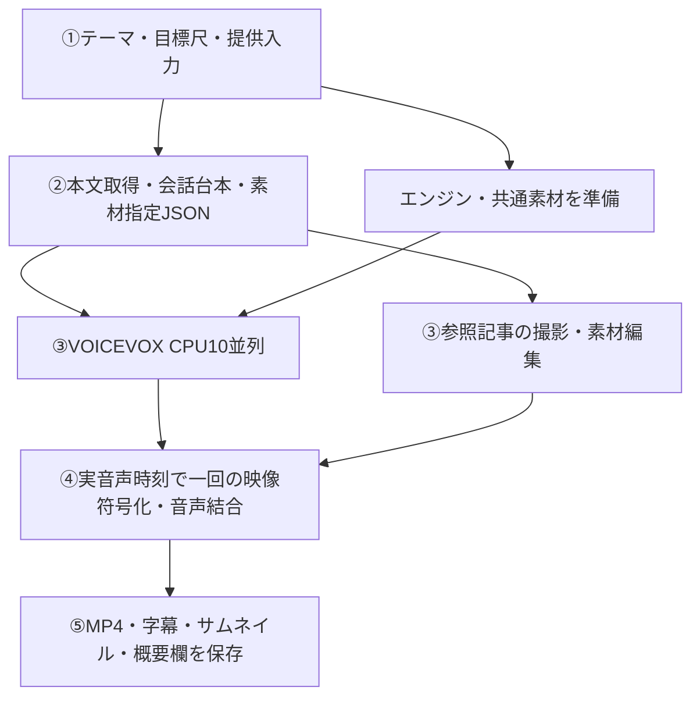

# このパイプラインのルール

開始・コンパクション後は本書を全文読む。同じセッションで内容が変わらなければ再読不要。CLAUDE.md・CHATGPT.md・AGENTS.mdは同じ本書への入口。旧VMの32件などを追加必読にせず、本書をVM全体のルールへ一括上書きしない。最新の利用者指示を優先する。

## 全体を把握する

目標は「入力→情報と台本→音声と素材→合成→保存」の5工程。下図は目標構成であり、未接続の並列処理や転送を実装済みと報告しない。

現行：情報準備と動画制作のActions入口は別。`production`のresearch-request入力では調査→台本→撮影→音声→描画の順に動く。音声と撮影の並行実行・テーマだけの統一入口・共通素材の独立登録・完成MP4のDrive自動転送は未実装。既存Drive同期はリポジトリのコードZIP用で、動画転送と混同しない。

- GitHub側の入口は `.github/workflows/voicevox-cpu-video.yml`。公式CPU配布の取得・キャッシュ・音声生成・MP4保存をランナー上で実行する。台本・原素材は提供ZIPから一時領域へ展開し、Gitへコミットしない。共有キャッシュは公式エンジンと公式フォントだけ。
- ローカルの入口は `./zundamon-video`、本体 `pipeline.py`、音声管理 `engine_pool.py`、描画は `renderer/render_reusable_landscape_raw.py`、見た目は `config/landscape_profile_v18.json`。
- 情報準備の入口は `tools/prepare_project.py` / `.github/workflows/prepare-project.yml`。提供台本を使う場合はLLMを呼ばない。台本APIは選択provider・model・認証・明示許可が揃った時だけ1回使い、有料fallbackは入れない。本文取得失敗や撮影失敗を成功扱いしない。
- OpenCodeは `provider:opencode` / `model:deepseek-v4.1-flash-free` のみ。公式CLI `opencode-ai@1.19.0` の一時ローカルサーバーを使い、直接API用のクライアント偽装はしない。ツールを承認せず、再試行・追加生成・別モデルを検知したら起動したプロセス群を終了する。動画workflowでは `script_provider:opencode` とZIP内providerを一致させる。
- `setup` は既存資産の場所を `runtime.local.json` に登録する初回処理。制作は `run project.json --out 新しい出力先` 一回で最後まで進める。
- `state.json` で現在工程を見る。`AUDIO → RENDER → COMPLETE`。実エラーは `FAILED` と原因を残す。失敗を成功と書かない。

## 実行方針

- **GPUは使わない。Colabを起動しない。VOICEVOX 0.25.2の独立CPUエンジン10個、各1スレッド。** 1個のエンジンへ10件投げる実装にはしない。英語用TTS・有料API・別モデルへの自動切替も入れない。
- 利用者の提供台本・画像・取得済み素材を使う。重複の情報収集・査読・監査・人への途中確認は不要。必要な入力形式・媒体読込み・共有ロックは処理の一部として使い、別の待ち工程を作らない。
- 依頼範囲を最後まで実行する。起動した10エンジンは成功・失敗のどちらでも終了する。既存のVOICEVOXや無関係なサービスは止めない。
- 新規台本の数字・日付・引用・出典を創作しない。素材の出典は入力と概要欄へ保持する。自動公開・外部送信はこのコマンドに含めない。

## 情報・台本・素材をつなぐ

- 制作の正本は`project.json`。台詞ID・話者・本文・必要な読み・表情・資料ID・任意SEを同じ台本で結ぶ。`research.json`は取得資料、撮影manifestは画像の記録。別々の台本を増やして手で時刻を合わせない。
- 新規調査は公式・一次資料を優先。RSSは発見用とし、本文取得できた記事だけを台本へ渡す。収集件数・本文取得件数・撮影件数を区別し、取得不能の理由を残す。Google News集約URLから配信元を解決する機能は未実装。見出しだけを全文取得扱いせず、ログイン・購読・接続制限を回避しない。
- 台本で実際に参照するURLだけを撮影する。先頭の`article`要素を本文と決めつけず、本文見出しと文章を持つ領域を選ぶ。必要時は資料IDごとの見出し・CSS領域・引用段落を明示する。関連記事・広告の画像を本文の代わりに使わない。
- 撮影は最大4並列、既存Cookieを流用しない。本文の切り抜きは高さ700px以内、内容を改変せずURL・撮影時刻・SHAを保存。明示した段落が見つからなければ別の段落へ黙って置換しない。元の画面と切り抜きは残す。
- 立ち絵・背景・提供動画・BGM・SEは承認済み素材を使い、公開Gitや共有キャッシュへ入れない。現行Actionsの共通素材は制作ZIPで渡す。毎回の素材再アップロード不要という運用は、別管理の接続後にだけ案内する。
- 目標尺は文字数だけで合格としない。実音声と最終MP4の尺で示し、指定の下限に届かない場合は内容不足として扱う。無音・同文反復・無断の話速変更で水増ししない。必要な内容修正は同じ作品の新しい入力・出力として残す。

## 映像と音声

- ずんだもんstyle3、四国めたんstyle2。VOICEVOXの実エンジン・CPU合成を記録し、GPU記録と混ぜない。
- 原音話速1.10、後段atempo1.15。原音も保存し、勝手な無音カットはしない。処理後WAVは48kHz mono PCM16、出力AACも48kHz mono。
- 最終動画は利用者指定の360p（640×360）・24fps、H.264 preset veryfast・CRF20。描画は1280×720の黒板、Zen Maru Gothic Medium 36px、最大3行で行い、最後に360pへ縮小する。BudouXの文節境界と禁則・数値単位の保護で折り返し、収まらなければ本文を保持して時間分割する。文字を縮小・欠落させて押し込まない。話者色は緑と桃。映像内と概要欄にVOICEVOX表記を出す。棒人間の50px設定をこの経路へ混ぜない。
- 英語の証拠画像には `source_language: en` と原文に忠実な `translation` を付け、画像直下の日本語訳枠へ表示する。長文は本文とフォントサイズを保ってページを切り替え、訳文をナレーション字幕と混同しない。原画像は書き換えない。英語と明示された画像で訳が欠けていれば停止する。
- BGMは配布元の利用条件と音源SHAを記録し、曲名・作者・ライセンス・必要なリンク・編集内容を概要欄に残す。音源を公開Gitへ入れない。話声でダッキングし、入りと終わりをフェードする。
- 承認済みのずんだもん・めたんの正規パーツを使う。表情は台詞IDの明示キュー。RMS窓0.03秒、閉口閾値0.014、大開き0.07。聞き手と無音は閉口。元の口へ別の口を描き足さない。
- 喜びは4秒で通常へ戻す。話す側285px、聞く側260px・不透明度0.5。喋り始めの既存の弾みを保つ。音声は既存のgain6.5dBとlimiter0.78、level=disabled。
- MoviePyで提供クリップの切り抜き・クロスフェード、CairoSVGで自己完結SVGの高解像度化、FFmpegで任意BGMのダッキングを行う。素材編集の符号化と完成映像の符号化を区別する。完成映像は一回符号化し、音声結合時に再符号化しない。複数の完成動画を同時描画しない。
- SEは提供音源を実VOICEVOX時刻へ配置し、推測した台詞長を使わない。任意の音量正規化は−17LUFS目標と既存limiterを保つ。サムネイルは実動画フレーム＋タイトルから1280×720で出力する。ランダムな効果・毎3秒の強制ズーム・−14LUFSへの一括変更はしない。
- 編集用SRT・ASS・VTTはpysubs2で、映像と同じ字幕状態・実音声区間から出力する。台詞内の字幕切替は文字数比による配分であり、単語・音素単位の強制アラインメントではない。ASSは編集用で、黒板や立ち絵を含む完成映像の再現ファイルではない。

## 保全と再開

- 成功した同一入力・同一SHAの音声と動画は再利用する。途中出力を成功扱いしない。自動の無制限再試行をしない。元動画・素材・別作業のGit差分は上書きしない。
- 秘密・認証・Cookie・APIキーを表示したりGitへ入れない。`git add .`、reset/clean、無断mergeを使わない。
- 関数名を保ち、変更先を読んで必要部分だけ編集する。コードを省略記号へ置き換えない。関係する動作だけを確かめ、過去の全テスト・全ログを毎回走査しない。
- 長い作業の保存メモは目的・変更・結果・残作業・次の一手だけ。Chat CLI等へ委任する時は本書全文を本文に渡し、ファイル名だけで読了としない。
- 所要時間は起動・依存準備・検索・台本・合成・撮影・描画・保存を区別する。並列工程の秒数を足して全体時間としない。全体を報告する時は開始から受け渡しまでの実時間とし、回収・選定・修正を除いた処理時間を全体時間と呼ばない。
- 実装・実行済み・成果物保存済みを区別する。`provider:none`は情報収集のみで、台本も画像も動画も自動生成しない。`RESEARCH_READY`・`PROJECT_READY`をMP4完成と呼ばず、テスト成功を全編の人による視聴や内容の全面的な正しさと同義にしない。
- ツールはCPUでの具体的な効果・依存量・利用条件・対応Pythonを比較して必要なものだけ採用する。最新版という理由だけで本体Pythonを変えず、互換版を固定する。必要な時だけ使い、全ツールの毎回起動や追加の査読工程を作らない。
